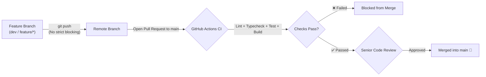

<div align="center">

# 📋 WORKBOARD

**A Scalable, Enterprise-Ready Full-Stack Task Management Platform**

Built with **Next.js 16 (App Router & Turbopack)**, **React 19**, **Supabase (Auth & PostgreSQL)**, and **Tailwind CSS v4**.

---

[](https://nextjs.org/)
[](https://react.dev/)
[](https://www.typescriptlang.org/)
[](https://supabase.com/)
[](https://tailwindcss.com/)
[](https://github.com/)

</div>

---

## 📖 Overview

**Workboard** is a modern task management system crafted with enterprise engineering standards in mind. It demonstrates how to build resilient, secure, and production-grade applications using the latest features of **Next.js 16**, **React 19 Server Actions**, and **Supabase SSR**.

The platform adheres to strict data security, database-level pagination, robust error masking, and corporate CI/CD review workflows.

---

## ✨ Key Features & Engineering Highlights

### 1. 🔐 Robust Authentication & Session Management
- **Supabase SSR Integration**: Cookie-based server-side session handling via `@supabase/ssr`.
- **Next.js 16 Proxy Convention**: Implements `src/proxy.ts` (the official successor to `middleware.ts` in Next.js 16) for seamless session refresh and token verification.
- **Protected Routes**: Automatic redirection to `/login` for unauthenticated sessions and `/dashboard` upon successful login.

### 2. ⚡ Database-Level Server Pagination
- **Efficient Querying**: Uses Supabase `.range(from, to)` and `{ count: 'exact' }` to query only the necessary records per page directly from PostgreSQL instead of in-memory client slicing.
- **Scalable Architecture**: Scales reliably to millions of tasks without degrading client performance or consuming server memory.
- **Dynamic Controls**: Includes Previous/Next buttons, direct page indexing, total records display, and URL state preservation.

### 3. 🛡️ Secure Error Handling & Data Sanitization
- **Information Leak Prevention**: Raw database errors, schema details, Postgres error codes, and sensitive server stack traces are sanitized and never exposed to the client.
- **Structured Feedback**: Distinct, user-friendly status messages (in Arabic) for input errors, unconfirmed emails, missing records, and internal server exceptions.
- **Audit Logging**: Comprehensive server-side logging with error codes and contextual metadata for observability.

### 4. ⏳ Loading & Pending States
- **Double Submission Guard**: Form action buttons (`SubmitButton`, `DeleteButton`) automatically disable (`disabled={pending}`) to prevent duplicate writes.
- **Visual Feedback**: Displays animated SVG loading spinners and contextual status labels (`Saving...`, `Creating task...`, `Deleting...`, `Signing out...`).
- **React 19 `useFormStatus`**: Clean component decoupling without prop drilling.

### 5. 🔍 Advanced Filtering & Sorting
- Real-time client search across task titles and descriptions.
- Multi-criteria filtering by **Status** (`todo`, `in_progress`, `completed`) and **Priority** (`low`, `medium`, `high`).
- Dynamic sorting by creation date, due date, and priority ranking.

---

## 🛠️ Tech Stack

| Category | Technology | Description |
| :--- | :--- | :--- |
| **Framework** | [Next.js 16.4.1](https://nextjs.org/) | App Router, Server Actions, Partial Prerendering, Turbopack |
| **UI Library** | [React 19.3.0](https://react.dev/) | Actions, `useFormStatus`, Server Components |
| **Language** | [TypeScript 5](https://www.typescriptlang.org/) | Strict type checking and full end-to-end type safety |
| **Styling** | [Tailwind CSS v4](https://tailwindcss.com/) | Next-generation utility-first CSS engine |
| **Backend & DB** | [Supabase](https://supabase.com/) | PostgreSQL database, Row Level Security (RLS), Auth |
| **Testing** | [Vitest](https://vitest.dev/) | High-speed unit testing suite |
| **CI / CD** | [GitHub Actions](https://github.com/features/actions) | Automated linting, type-checking, testing, and building |

---

## 📂 Project Structure

```text
workboard/
├── .github/
│   ├── workflows/
│   │   └── ci.yml                   # CI pipeline (Lint, Typecheck, Test, Build)
│   └── pull_request_template.md     # PR template with Senior Review checklist
├── public/                          # Static assets
├── src/
│   ├── app/
│   │   ├── api/
│   │   │   └── health/
│   │   │       └── supabase/        # Supabase connectivity health check route
│   │   ├── auth/
│   │   │   └── actions.ts           # Authentication Server Actions (login, logout)
│   │   ├── dashboard/
│   │   │   ├── actions.ts           # Task Server Actions (create, update, delete)
│   │   │   ├── page.tsx             # Protected Dashboard with statistics & pagination
│   │   │   ├── TaskList.tsx         # Client component for search, filters, & sorting
│   │   │   ├── Pagination.tsx       # Reusable database pagination controls
│   │   │   ├── SubmitButton.tsx     # Pending-aware submit button with animated spinner
│   │   │   └── DeleteButton.tsx     # Delete button with confirmation and pending state
│   │   ├── login/
│   │   │   └── page.tsx             # Secure login page with error alerts
│   │   ├── globals.css              # Global styles and Tailwind configuration
│   │   └── layout.tsx               # Root layout with Geist fonts
│   ├── lib/
│   │   └── supabase/
│   │       ├── client.ts            # Client-side Supabase browser factory
│   │       ├── server.ts            # Server-side Supabase client with cookie storage
│   │       └── proxy.ts             # Proxy helper for session refreshing
│   └── proxy.ts                     # Next.js 16 Proxy (replaces legacy middleware)
├── .env.local                       # Local environment secrets (ignored by Git)
├── next.config.ts                   # Next.js configuration (Turbopack, cache flags)
├── package.json                     # Project scripts and dependencies
└── tsconfig.json                    # TypeScript compiler configuration
```

---

## 🗄️ Database Schema & Security (Supabase)

Execute the following SQL in your **Supabase SQL Editor** to initialize the database with **Row Level Security (RLS)**:

```sql
-- 1. Create Tasks Table
CREATE TABLE IF NOT EXISTS public.tasks (
    id UUID PRIMARY KEY DEFAULT gen_random_uuid(),
    user_id UUID NOT NULL REFERENCES auth.users(id) ON DELETE CASCADE,
    title VARCHAR(200) NOT NULL,
    description TEXT,
    status VARCHAR(20) NOT NULL DEFAULT 'todo' CHECK (status IN ('todo', 'in_progress', 'completed')),
    priority VARCHAR(10) NOT NULL DEFAULT 'medium' CHECK (priority IN ('low', 'medium', 'high')),
    due_date DATE,
    created_at TIMESTAMPTZ NOT NULL DEFAULT timezone('utc'::text, now()),
    updated_at TIMESTAMPTZ NOT NULL DEFAULT timezone('utc'::text, now())
);

-- 2. Performance Indexes
CREATE INDEX IF NOT EXISTS idx_tasks_user_id ON public.tasks(user_id);
CREATE INDEX IF NOT EXISTS idx_tasks_created_at ON public.tasks(created_at DESC);
CREATE INDEX IF NOT EXISTS idx_tasks_status ON public.tasks(status);

-- 3. Enable Row Level Security (RLS)
ALTER TABLE public.tasks ENABLE ROW LEVEL SECURITY;

-- 4. RLS Policies (Users can only access their own tasks)
CREATE POLICY "Users can view their own tasks"
    ON public.tasks FOR SELECT
    USING (auth.uid() = user_id);

CREATE POLICY "Users can create their own tasks"
    ON public.tasks FOR INSERT
    WITH CHECK (auth.uid() = user_id);

CREATE POLICY "Users can update their own tasks"
    ON public.tasks FOR UPDATE
    USING (auth.uid() = user_id)
    WITH CHECK (auth.uid() = user_id);

CREATE POLICY "Users can delete their own tasks"
    ON public.tasks FOR DELETE
    USING (auth.uid() = user_id);
```

---

## 🚀 Getting Started

### Prerequisites
- **Node.js**: `v20.x` or higher
- **npm**: `v10.x` or higher
- A free [Supabase Account](https://supabase.com/) with an active project

### 1. Clone the Repository
```bash
git clone https://github.com/your-username/workboard.git
cd workboard
```

### 2. Install Dependencies
```bash
npm install
```

### 3. Configure Environment Variables
Create a `.env.local` file in the root directory:

```env
# Supabase Project Base URL (Do NOT append /rest/v1/)
NEXT_PUBLIC_SUPABASE_URL=https://your-project-ref.supabase.co

# Supabase Publishable / Anon API Key
NEXT_PUBLIC_SUPABASE_PUBLISHABLE_KEY=sb_publishable_your_key_here
```

### 4. Run the Development Server
```bash
npm run dev
```

Visit [http://localhost:3000](http://localhost:3000) to access the application.

---

## 📜 Available NPM Scripts

| Script | Command | Purpose |
| :--- | :--- | :--- |
| `npm run dev` | `next dev` | Starts the development server with Turbopack |
| `npm run build` | `next build` | Creates an optimized production build |
| `npm run start` | `next start` | Runs the production build locally |
| `npm run lint` | `eslint` | Runs ESLint static analysis across the codebase |
| `npm run typecheck` | `tsc --noEmit` | Validates TypeScript types across all files |
| `npm run test` | `vitest run` | Executes unit tests via Vitest |
| `npm run check` | `npm run lint && npm run typecheck && npm run test` | Runs all static and unit verification checks |
| `npm run verify` | `npm run check && npm run build` | Complete pre-deployment validation pipeline |

---

## 🏢 Corporate Git & CI/CD Workflow

The repository is configured to simulate enterprise development best practices:



1. **Feature Branches (`dev`, `feature/*`)**: Developers work in feature branches and push changes freely without premature pipeline blockades.
2. **Pull Request Validation**: When a PR is created against `main`, GitHub Actions triggers the automated CI pipeline.
3. **Protected `main` Branch**: Direct commits to `main` are restricted. Merging requires:
   - Green CI status check (`Lint, Typecheck, Test & Build`).
   - Code review approval by a Senior Developer.
   - Standard Pull Request template checklist completion.

---

## 🔒 Security Practices

- **Zero Secret Exposure**: Public keys use `NEXT_PUBLIC_` prefixes, while server logic and credentials remain isolated.
- **Strict Parameter Validation**: Every Server Action validates UUIDs, field lengths, dates, and allowed enums before executing queries.
- **Row Level Security**: PostgreSQL RLS policies enforce tenant isolation directly at the database engine layer.

---

## 📄 License

This project is licensed under the [MIT License](LICENSE).
